<a href="https://redops-tech.com">
  <picture>
    <source media="(prefers-color-scheme: dark)" srcset="assets/hero-dark.svg">
    
  </picture>
</a>

  <a href="https://redops-tech.com"><b>redops-tech.com</b></a>
  &nbsp;·&nbsp;
  <a href="https://redops-tech.com/book">Book a call</a>
  &nbsp;·&nbsp;
  <a href="https://redops-tech.com/free-audit">Free audit</a>
  &nbsp;·&nbsp;
  <a href="https://redops-tech.com/resources/">Resources</a>
  &nbsp;·&nbsp;
  <a href="https://redops-tech.com/careers">Careers</a>
  &nbsp;·&nbsp;
  <a href="https://www.linkedin.com/company/redops-tech">LinkedIn</a>

 

## Two practices.

  <a href="https://redops-tech.com/services/edge-cloud"><picture>
    <source media="(prefers-color-scheme: dark)" srcset="assets/practice-edge-dark.svg">
    
  </picture></a>
  <a href="https://redops-tech.com/services/erp"><picture>
    <source media="(prefers-color-scheme: dark)" srcset="assets/practice-erp-dark.svg">
    
  </picture></a>

## Products.

  <a href="https://redops-tech.com/products/redops-ai"><picture>
    <source media="(prefers-color-scheme: dark)" srcset="assets/product-redops-ai-dark.svg">
    
  </picture></a>
  <a href="https://redops-tech.com/products/redops-insights"><picture>
    <source media="(prefers-color-scheme: dark)" srcset="assets/product-redops-insights-dark.svg">
    
  </picture></a>
  <a href="https://redops-tech.com/products"><picture>
    <source media="(prefers-color-scheme: dark)" srcset="assets/product-nolagchess-dark.svg">
    
  </picture></a>
  <a href="https://redops-tech.com/products/el-fatoora"><picture>
    <source media="(prefers-color-scheme: dark)" srcset="assets/product-el-fatoora-dark.svg">
    
  </picture></a>

## How we work.

<picture>
  <source media="(prefers-color-scheme: dark)" srcset="assets/how-dark.svg">
  
</picture>

 

  <b>Operate smarter. Grow faster.</b> RedOps Technologies · Tunis, Tunisia · <a href="mailto:hello@redops-tech.com">hello@redops-tech.com</a>

